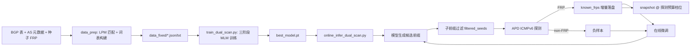

# 6FRP — IPv6 全响应前缀（Fully-Responsive Prefix）发现系统

> 基于 **DualScanHMamba**（Dual-Scan Hierarchical Mamba）的 IPv6 FRP（Fully-Responsive Prefix / 全响应前缀，也常称为"别名前缀 Aliased Prefix"）在线发现与主动探测闭环系统。
>
> **关键词**：IPv6 测量 · FRP / 别名前缀 · 分层掩码语言模型（MLM）· 状态空间模型（SSM / Mamba）· ICMPv6 主动探测（APD）· 在线微调

---

## 目录
- [1. 项目简介](#1-项目简介)
- [2. 技术方案](#2-技术方案)
- [3. 目录结构](#3-目录结构)
- [4. 环境要求](#4-环境要求)
- [5. 快速开始](#5-快速开始)
- [6. 详细使用说明](#6-详细使用说明)
- [7. 关键参数一览](#7-关键参数一览)
- [8. 输出产物](#8-输出产物)
- [9. 性能与数据规模](#9-性能与数据规模)
- [10. 相关工作与对比](#10-相关工作与对比)
- [11. 常见问题（FAQ）](#11-常见问题faq)
- [12. 维护与交接](#12-维护与交接)

---

## 1. 项目简介

**FRP（Fully-Responsive Prefix）** 指 IPv6 中"任意子地址都会响应 ICMPv6 Echo"的前缀，常见于别名前缀（Aliased Prefix）、CDN 边界、NAT64 等场景。FRP 识别对 IPv6 地址发现、拓扑测量、Hitlist 质量控制至关重要——未识别的 FRP 会导致 TGA（Target Generation Algorithm）生成大量"看似活跃但实为别名"的伪地址，严重污染测量结果。

**6FRP 的目标**：在给定有限的 FRP 种子集的前提下，**穷尽式**发现互联网上尽可能多的新 FRP，并在探测过程中**在线细化**生成模型。

本项目核心能力：

- 🧠 **DualScanHMamba 生成模型**：Outer-Scan（128-bit 前缀层级）+ Inner-Scan（AS 内样本间）+ Gating Fusion，用三阶段分层 MLM（coarse / medium / fine）学习 FRP 的位级分布。
- 🎯 **分阶段候选生成**：按 coarse (0-32bit) → medium (32-64bit) → fine (64-128bit) 逐层掩码采样，温度可控。
- 📡 **ICMPv6 APD 主动探测**：原始 Socket 发送 Echo Request，默认 16 子前缀抽样，success_rate ≥ 0.875 判 FRP，支持**树对齐**（Tree Alignment）细化到最大子 FRP。
- 🔁 **在线闭环微调**：探测结果（confirmed FRP / non-FRP）作为反馈信号即时微调模型，边探测边学习。
- 💾 **全量状态持久化**：known FRP 增量落盘，支持跨 session 续跑；支持按探测包预算（如 500k / 2.5M / 4.5M / 6.5M）打快照。

---

## 2. 技术方案

### 2.1 整体流程



### 2.2 DualScanHMamba 模型

- **Outer Scan**：沿 128-bit 前缀方向的 selective-scan（纯 PyTorch 实现的 S6），捕获"从网络号到接口号"的层级依赖。
- **Inner Scan**：在同一 batch（同 AS / 同类别）样本之间，按每个 bit 位置扫描，捕获 AS 本地的共享子前缀模式。
- **Gating Fusion**：以 AS embedding 为条件，自适应融合 Outer / Inner 两路特征。
- **Metadata 条件**：AS id（词表 300）、org id（273）、cat1/cat2（15/24）、proto（4）、geo（51）、RTT 统计（mean/std/min）共同拼接到位编码上。
- **训练目标**：三阶段分层 Masked Language Modeling —— `coarse` 掩 0-32 bit、`medium` 掩 32-64 bit、`fine` 掩 64-128 bit，可选位熵加权。

### 2.3 APD（Aliased Prefix Detection）

- 对候选前缀，在其下随机采样 16 个子前缀，每个子前缀发送最多 5 次 ICMPv6 Echo（1/s）。
- 若全部 16 个子前缀都有响应 → 判 FRP；若 ≥ 14/16 → 可配置阈值判 FRP。
- 若非 FRP，启用**树对齐细化**：根据哪些 nibble 响应，自动聚合为最短覆盖子 FRP 候选，递归下探。

---

## 3. 目录结构

```text
6FRP/
├── README.md                       # 本文件
├── 探测项目SOP.docx                # 项目部署/运行 SOP（交接文档）
├── fill_sop.py                     # SOP 填充脚本
│
├── data_prep/                      # 数据预处理
│   ├── __init__.py
│   └── prepare.py                  # BGP + AS 元数据 + 种子 → data_fixed/*
│
├── data/                           # 原始数据
│   ├── ipasn_20260429.dat          # BGP 前缀表（5.9 MB）
│   ├── as_org_category.csv         # AS 组织/类别元数据（9.3 MB）
│   ├── seeds.txt                   # 原始种子前缀列表（5.07 MB）
│   └── Gungnir_seeds_original.txt  # 对比基线种子
│
├── data_fixed/                     # 预处理产物（训练直接用）
│   ├── seeds_prepared.txt          # 归一化后的种子
│   ├── filtered_seeds.txt          # 用于在线推理过滤的种子
│   ├── meta.json                   # 每个种子的 AS/org/geo/rtt 元数据（45 MB）
│   ├── as_seed_db.json             # AS → 种子集合映射
│   ├── vocabs.json                 # AS/org/country/cat1/cat2 词表
│   └── stats.json                  # 数据统计（词表大小、种子数等）
│
├── generators/                     # 模型实现
│   ├── dual_scan_hmamba.py         # ⭐ DualScanHMamba 主模型
│   ├── hmamba.py                   # 基线 HMamba
│   ├── unified.py                  # Unified 对比模型
│   ├── inner_only_mamba.py         # 消融：仅 Inner Scan
│   ├── outer_only_mamba.py         # 消融：仅 Outer Scan
│   ├── compare_models.py           # 多模型对比脚本
│   ├── visualize_full_hmamba.py    # 架构可视化
│   └── demonstrate_hmamba_flow.py  # 推理 flow 演示
│
├── utils/                          # 公共工具
│   ├── apd.py                      # APD 高层接口（LocalAPDProber / SimulatedAPDProber）
│   ├── apd_core.py                 # APD 核心：ICMPv6 原始 socket、树对齐细化
│   ├── ipv6_utils.py               # 前缀生成/归一化/子网判断
│   └── entropy_analysis.py         # 位熵分析，用于 MLM 加权
│
├── checkpoints/                    # 训练产物
│   └── dual_scan/
│       ├── best_model.pt           # ⭐ 最佳 val-loss 模型（8.3 MB）
│       ├── checkpoint_epoch{4,9,14,19}.pt
│       └── config.json             # 模型超参
│
├── train_dual_scan.py              # ⭐ 训练入口
├── debug_train.py                  # 单 batch 调试训练
├── online_infer_dual_scan.py       # ⭐ 在线推理 + APD 闭环入口
├── standalone_apd.py               # 独立 APD（不走模型，纯 ICMPv6）
│
├── results/                        # 推理运行结果
│   └── online_run1/
│       ├── confirmed_frps.txt      # 最终 FRP 列表
│       ├── round_results.json      # 每轮详情
│       ├── summary.json            # 汇总（discovery_rate 等）
│       ├── known_frps.txt          # 累计 known FRP
│       ├── known_frps_merged.txt   # 结束时合并快照
│       ├── live_frp.log            # 实时 FRP 增量日志
│       ├── snapshots/              # 探测包预算档位快照
│       └── model_final.pt          # 终态模型
│
├── space_count/                    # 覆盖率/熵分析与绘图
│   ├── count.py                    # 覆盖率统计
│   ├── plot_comparison.py          # 多方法对比曲线
│   ├── plot_arch.py                # 架构图绘制
│   ├── plot_arch_and_entropy.py
│   ├── fill_cleaned.py
│   ├── 6FRP/ Gungnir/ Luori/       # 各方法在 2M-10M 探测预算下的统计
│   ├── count_results/              # 聚合统计结果
│   ├── frps/                       # 各方法 FRP 列表
│   ├── *.pdf / *.png               # 论文插图
│   └── 6FRP_infocom2027.tex        # 论文 LaTeX 稿
│
├── paper/                          # 论文稿件
│   ├── 6FRP.docx
│   ├── Heimdall.tex / Heimdall.docx
│   ├── Heimdall_Sharing.pptx
│   ├── Heimdall_Speech.md
│   ├── 9-14.md                     # 方法与相关工作总结
│   ├── convert_to_docx.py
│   └── make_heimdall_ppt.py
│
├── test.py                         # 单元/集成测试
├── dedup_ipv6_prefixes.py          # IPv6 前缀去重工具
├── find_middle_jsonl.py            # 中间结果辅助工具
└── gungnir.txt                     # Gungnir 对比数据
```

---

## 4. 环境要求

| 组件 | 版本 / 规格 |
|---|---|
| OS | Linux x86_64（已验证：TencentOS Server 4.4 / Linux 6.6）；兼容 CentOS 8+ / Ubuntu 22.04+ |
| Python | 3.11（推荐 3.11.6） |
| PyTorch | 2.12.0（CPU 可运行；本项目 selective-scan 为纯 PyTorch 实现，**不依赖** `mamba-ssm` / `causal-conv1d` 等 CUDA 扩展） |
| numpy | ≥ 2.0 |
| requests | ≥ 2.30（可选，远程 APD 场景） |
| 内存 | ≥ 8 GB（推荐 16 GB） |
| 硬盘 | ≥ 40 GB（含数据/模型/日志） |
| GPU | 可选，CPU 可完成全流程推理；大批量训练建议 ≥ 8 GB 显存 |
| CPU | ≥ 4 核（APD 并发建议 ≥ 8 核） |
| 网络 | **需要一个可用的 IPv6 全球单播地址**；且需 `root` 或 `CAP_NET_RAW` 权限以发送原始 ICMPv6 包 |

---

## 5. 快速开始

### 5.1 安装依赖

```bash
cd /root/6FRP
pip3 install --upgrade pip
pip3 install torch==2.12.0 numpy requests
```

### 5.2 验证环境

```bash
python3 -c "import torch; \
    ckpt = torch.load('checkpoints/dual_scan/best_model.pt', map_location='cpu'); \
    print('keys:', list(ckpt.keys())); \
    print('config:', ckpt['config'])"

ip -6 addr | grep -E 'inet6 .* scope global' | head -3   # 应至少有一条
```

### 5.3 Dry-Run（无网络，模拟 APD）

```bash
python3 online_infer_dual_scan.py \
    --checkpoint checkpoints/dual_scan/best_model.pt \
    --data-dir data_fixed \
    --output-dir results/dry_run \
    --rounds 3 --candidates-per-round 50 \
    --dry-run
```

### 5.4 正式在线推理（需 root）

```bash
sudo python3 online_infer_dual_scan.py \
    --checkpoint checkpoints/dual_scan/best_model.pt \
    --data-dir data_fixed \
    --output-dir results/online_run1 \
    --candidates-per-round 500 \
    --temperature 0.8 \
    --apd-concurrency 8 --apd-workers 4 \
    --max-total-probes 6500000 \
    --bootstrap-known-from-seeds
```

---

## 6. 详细使用说明

### 6.1 数据预处理（可选，重建数据集时用）

```bash
python3 -m data_prep.prepare \
    --bgp-table data/ipasn_20260429.dat \
    --as-meta   data/as_org_category.csv \
    --seeds     data/seeds.txt \
    --out-dir   data_fixed
```

输出：
- `seeds_prepared.txt` 归一化种子
- `meta.json` 每种子 AS/org/geo/rtt 元数据
- `as_seed_db.json` AS → 种子集合
- `vocabs.json` 词表映射
- `stats.json` 统计
- `filtered_seeds.txt` 用于在线推理过滤的种子

> ⚠️ 若种子中出现新 AS，必须重跑此步，否则推理时会 OOV。

### 6.2 训练模型（可选，重新训练时用）

```bash
python3 train_dual_scan.py \
    --data-dir   data_fixed \
    --output-dir checkpoints/dual_scan \
    --epochs 30 --batch-size 64 --lr 3e-4 \
    --d-model 128 --num-layers 4 --ssm-d-state 16 \
    --num-workers 4 \
    --save-every 5
```

训练过程打印：
```
Epoch 12/29 (183.4s) | Train Loss: 0.3421 Acc: 0.8912 | Val Loss: 0.3188 Acc: 0.9015 | Stages: C=... M=... F=...
  -> New best model saved (val_loss=0.3188)
```

产物：`best_model.pt`（val-loss 最优）、`checkpoint_epoch{N}.pt`、`train_history.json`、`config.json`。

### 6.3 在线推理 + APD 闭环（主流程）

```bash
sudo python3 online_infer_dual_scan.py \
    --checkpoint    checkpoints/dual_scan/best_model.pt \
    --data-dir      data_fixed \
    --output-dir    results/online_run1 \
    --candidates-per-round 500 \
    --temperature   0.8 \
    --adaptive-temperature \
    --apd-timeout   2.0  \
    --apd-max-attempts 5 \
    --apd-concurrency  8 \
    --apd-workers      4 \
    --apd-refine \
    --finetune-lr      1e-4 \
    --finetune-steps   10  \
    --finetune-probe-threshold 200 \
    --max-total-probes         6500000 \
    --snapshot-probe-targets   500000 2500000 4500000 6500000 \
    --bootstrap-known-from-seeds \
    --torch-threads 2
```

一轮典型流程：
1. 生成 500 个候选前缀；
2. 过滤掉是 `filtered_seeds` 子前缀的候选；
3. 对剩余候选并行 APD（4 worker × 8 concurrency）；
4. 累计新 FRP 到 `known_frps.txt`，非 FRP 写入负样本池；
5. 每累积 200 个新探测结果触发一次在线微调（10 steps，lr=1e-4）；
6. 到达下一个 snapshot 预算档位时打快照。

### 6.4 独立 APD（不走模型）

```bash
python3 standalone_apd.py \
    --input   prefixes.txt \
    --output  apd_result.json \
    --probe-count 16 \
    --timeout 2.0 \
    --concurrency 8 \
    --ta                    # 启用树对齐细化
```

适用场景：对任意外部前缀列表（BGP 全表、Gungnir / Luori / AddrProbe 的候选集）跑 FRP 判定并做基线对比。

---

## 7. 关键参数一览

### 7.1 训练（`train_dual_scan.py`）

| 参数 | 默认 | 说明 |
|---|---|---|
| `--epochs` | 30 | 训练轮数 |
| `--batch-size` | 64 | batch 大小 |
| `--lr` | 3e-4 | 初始学习率（配 Cosine 衰减到 1% × lr） |
| `--weight-decay` | 1e-4 | AdamW 权重衰减 |
| `--d-model` | 128 | 隐藏维度 |
| `--num-layers` | 4 | DualScan 层数 |
| `--ssm-d-state` | 16 | SSM 状态维度 |
| `--val-split` | 0.05 | 验证集比例 |
| `--entropy-file` | None | 位熵权重 json，用于加权 MLM |
| `--resume` | None | 从 checkpoint 恢复 |

### 7.2 在线推理（`online_infer_dual_scan.py`）

| 参数 | 默认 | 说明 |
|---|---|---|
| `--candidates-per-round` | 500 | 每轮生成候选数 |
| `--temperature` | 0.8 | 采样温度 |
| `--adaptive-temperature` | off | 按 FRP 命中率自适应调温 |
| `--apd-timeout` | 2.0 | APD 单次探测超时(s) |
| `--apd-max-attempts` | 5 | APD 最大重试 |
| `--apd-concurrency` | 8 | 单前缀内并行度 |
| `--apd-workers` | 4 | 前缀级 worker 数 |
| `--apd-refine` | on | 启用树对齐细化 |
| `--finetune-lr` | 1e-4 | 在线微调学习率 |
| `--finetune-steps` | 10 | 每次微调步数 |
| `--finetune-probe-threshold` | 200 | 积累多少新探测结果后触发微调 |
| `--max-total-probes` | 6,500,000 | 全局探测包硬上限 |
| `--snapshot-probe-targets` | 500k 2.5M 4.5M 6.5M | 快照档位 |
| `--known-frps` | `<out>/known_frps.txt` | 持久化 FRP 文件 |
| `--bootstrap-known-from-seeds` | off | 从 `filtered_seeds` 初始化 known 集 |
| `--dry-run` | off | 模拟 APD，不发真包 |

---

## 8. 输出产物

运行 `online_infer_dual_scan.py` 后，`--output-dir` 下会生成：

| 文件 | 说明 |
|---|---|
| `confirmed_frps.txt` | 最终确认的 FRP 列表（每行一个前缀） |
| `known_frps.txt` | 累计 known FRP（跨 session 续跑） |
| `known_frps_merged.txt` | 结束时合并写出的完整 FRP 快照 |
| `round_results.json` | 每轮候选数、FRP 数、non-FRP 数、discovery_rate、累计探测包 |
| `summary.json` | 全局汇总（total_rounds, total_frps, discovery_rate 等） |
| `live_frp.log` | 实时增量 FRP 日志（可 `tail -f` 观察） |
| `snapshots/snap_<N>probes.txt` | 探测包预算档位的 FRP 快照 |
| `model_final.pt` | 结束时的模型（含累计 FRP、总探测包数等信息） |

---

## 9. 性能与数据规模

| 指标 | 当前实测/配置 |
|---|---|
| 种子数 | 214,158（输入） / 214,102（成功解析） |
| 覆盖 AS 数 | 299（词表压缩后） |
| 覆盖国家数 | 51 |
| cat1 / cat2 类别数 | 15 / 24 |
| 模型参数量 | ≈ 1–2 M（d_model=128, 4 layers） |
| 最佳 checkpoint | `checkpoints/dual_scan/best_model.pt`（2025-07-05 训练） |
| 典型单次运行预算 | 6.5 M 次 ICMPv6 探测包 |
| 快照档位 | 500k / 2.5M / 4.5M / 6.5M 次探测包 |
| APD 判 FRP 阈值 | success_rate ≥ 0.875（16 探测中 ≥ 14 响应） |
| CPU 单机吞吐 | 约 2k-5k 探测包/分钟（取决于 `apd-workers × concurrency` 和网络 RTT） |

---

## 10. 相关工作与对比

本项目配套的对比方法均位于 `space_count/`，详细方法笔记见 `paper/9-14.md`。

| 方法 | 发表 | 思路 | 本项目中的位置 |
|---|---|---|---|
| **Gungnir** | ICNP 2025 | 分层 Transformer + 种子生成 | `data/Gungnir_seeds_original.txt`、`space_count/Gungnir/` |
| **Luori** | TON 2026 | 查找表 + MCTS 搜索 | `/root/Luori/`、`space_count/Luori/` |
| **AddrProbe** | ToN 2025/2026 | CVAE + 跨前缀模式迁移 | `/root/AddrProbe/` |
| **PaS** | INFOCOM 2025 | 自顶向下剪枝式穷尽扫描 | 对比基线（参考 `paper/9-14.md`） |
| **SubRecon** | ICNP 2025 | 子网划分识别 + 覆盖扩展 | 对比基线（参考 `paper/9-14.md`） |
| **6FRP（本项目）** | infocom2027 投稿 | **DualScanHMamba + 在线闭环 APD** | 本仓库 |

`space_count/plot_comparison.py` 可生成多方法在 2M–10M 探测预算下的 FRP 发现曲线、地址空间覆盖、国家/类别覆盖等对比图。

---

## 11. 常见问题（FAQ）

**Q1：为什么必须 root？**
A：`utils/apd_core.py` 使用原始 ICMPv6 socket 发送 Echo Request，Linux 下只有 root 或拥有 `CAP_NET_RAW` 的进程可以创建。替代方案：
```bash
sudo setcap cap_net_raw+ep $(readlink -f $(which python3))
```

**Q2：APD 全部超时怎么办？**
A：按序排查：
1. `ip -6 addr` 看是否有 `scope global` 的 IPv6 地址；
2. `ping6 -c 3 2001:4860:4860::8888`（Google DNS）看出口 IPv6 是否通；
3. 云厂商安全组是否允许出站 ICMPv6；
4. 以 root 运行；
5. 加大 `--apd-timeout`（如 3-5 秒），减小 `--apd-concurrency`。

**Q3：训练内存爆了？**
A：PyTorch 2.12 的 selective-scan 是 CPU 纯实现，内存随 `batch_size × seq_len × d_model × d_state` 线性增长。建议：
- `--batch-size 32`（甚至 16）
- `--num-workers 2`
- 若有 GPU，使用 CUDA 版 torch 可大幅缓解。

**Q4：候选生成全是种子的子前缀？**
A：开启 `--bootstrap-known-from-seeds` 后，known 集会从 `filtered_seeds` 初始化，候选中是种子子前缀的会被**自动确认**而不发包；若仍想生成"全新"候选，可提高 `--temperature`（如 1.0-1.2）或增大 `--candidates-per-round`。

**Q5：想续跑一个被中断的任务？**
A：直接用同样的 `--output-dir` 再启动即可——`known_frps.txt` 会被加载，`model_final.pt` 可以通过 `--checkpoint` 作为新的起点。

**Q6：如何复现论文数字？**
A：
1. 用 `data_fixed/` 原生数据；
2. `python3 train_dual_scan.py --epochs 30 --batch-size 64 --seed 42`；
3. `sudo python3 online_infer_dual_scan.py --max-total-probes 10000000 --snapshot-probe-targets 2000000 4000000 6000000 8000000 10000000`；
4. 用 `space_count/count.py` 对每个 snapshot 统计覆盖率/熵，再用 `plot_comparison.py` 画图。

---

## 12. 维护与交接

- **当前主机**：`VM-42-229-tencentos` (`21.214.42.229`)
- **项目路径**：`/root/6FRP`
- **运行用户**：`root`（原始 ICMPv6 socket 需要）
- **SOP 文档**：`探测项目SOP.docx`（含环境、源码、人员、安装、运行、远程信息完整表格）
- **论文稿**：`paper/6FRP.docx`、`space_count/6FRP_infocom2027.tex`
- **方法笔记**：`paper/9-14.md`
- **交接建议**：
  1. 将 `/root/6FRP` 推送到团队 Git（排除 `__pycache__/`、`results/*/snapshots/`、大型 `.pt` 可用 LFS 或单独数据服务器托管）；
  2. 新接手人在 `探测项目SOP.docx` 的"管理人员信息"表格中填入自己信息，并把 SSH 公钥追加到 `/root/.ssh/authorized_keys`；
  3. 若种子/BGP 表更新，务必重跑 `data_prep.prepare`，再决定是否重新训练。

---

## 许可 / 引用

本项目当前作为学术研究代码使用，正式许可待发布。
若在学术工作中使用本代码或数据，请引用项目配套论文（见 `paper/`）。
