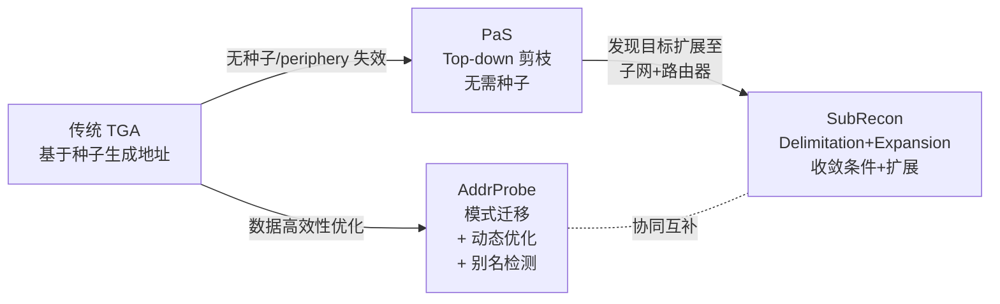
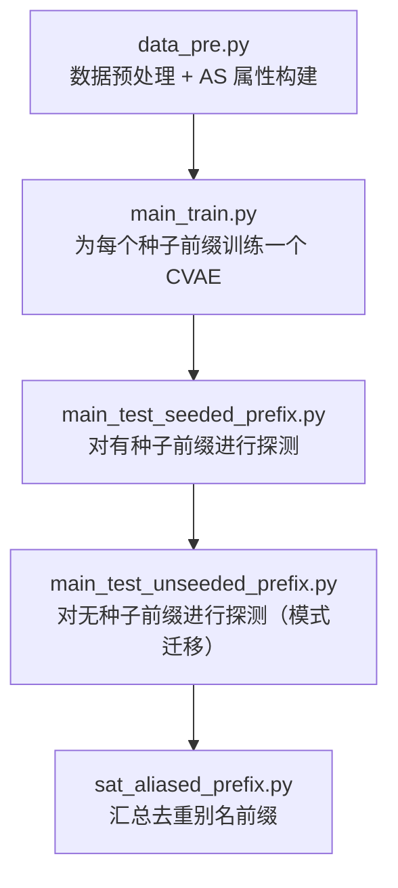
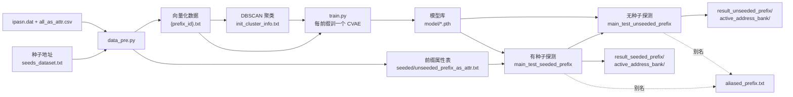

我来快速分析论文 6-8 的方法和原理。这三篇论文都属于**路由前缀穷尽/系统性探测**方向，我先并行搜索它们的详细技术内容。
[联网搜索中]
[联网搜索中]
[联网搜索中]
已经掌握三篇论文的核心方法，下面给出精炼分析：

---

# 论文 6-8 方法与原理分析

## 📌 论文 6：PaS（Pruning-as-Scanning）
> **Pruning as Scanning: Towards Internet-Wide IPv6 Network Periphery Discovery**  
> Tao Yang, Ling Hu, Bingnan Hou 等（国防科技大学），INFOCOM 2025

### 🎯 解决的问题
传统基于种子的 **TGA（Target Generation Algorithm）** 目标：发现活跃主机。但 **IPv6 网络外围（Periphery）设备**（末跳路由器、家庭网关、蜂窝设备）的地址模式与主机模式差异很大——TGA 学到的模式和 periphery 地址的分布**不匹配**，导致外围发现率低。

### 🔑 核心思想："以剪枝作为扫描"
放弃"从种子生成候选地址"的传统范式，改为 **"从整个 IPv6 空间自顶向下逐层剪枝"**，本质是**无种子**的分层搜索。

### ⚙️ 关键机制

1. **层次化探测（Hierarchical Probing）**
   - 从最短前缀（如 BGP 宣告的 /24、/32）开始，逐层深入到更长前缀
   - 每一层对该前缀进行**抽样探测**，不响应则**剪掉**该子树，避免继续搜索无关空间

2. **PaS 目标地址构造**（论文 Fig.5）
   对于一个被探测的前缀，其探测地址由三部分组成：
   ```
   [ 固定前缀 bits ] [ 中间采样 bits ] [ 随机化 IID (低 64 位) ]
   ```
   - **固定前缀 bits**：当前层级要探测的前缀
   - **中间 bits**：用于在该层级内采样，判断该子空间是否值得下探
   - **随机 IID**：探测使用 traceroute 类方式命中末跳 router

3. **异步扫描器实现**
   - 因为搜索树巨大，同步等待响应无法接受
   - 实现异步 scanner 原型，边发包边根据响应剪枝

### 📊 关键成果
- 使用 33B 探测包发现 **7.12 亿**个 IPv6 periphery 地址
- 上行 50 kpps 情况下**平均每小时 4M 地址**
- 首次实现全球规模 IPv6 网络外围的**穷尽发现**

### 💡 与"路由前缀穷尽探测"的契合点
**极其契合**——PaS 本质就是一种**无种子的、对整个 IPv6 空间进行系统性剪枝式穷尽扫描**的方法。

---

## 📌 论文 7：SubRecon
> **SubRecon: Efficient Internet-wide IPv6 Subnet Discovery and Its Applications**  
> Jiasheng Zhou, Ying Liu, Lin He 等（清华 ThunLab），ICNP 2025

### 🎯 解决的问题
IPv6 中运营商通常给用户**分配一段前缀**，而非单个地址。用户可自行将该前缀作为单个子网使用，也可再划分成多个子网。**"实际子网划分粒度"**（比如 /48、/56、/60、/64 等）在测量前是未知的，且各 AS 差异很大。识别真实子网粒度对提高测量精度、拓扑发现质量至关重要。

### 🔑 核心思想：Delimitation + Expansion 两阶段

#### **阶段一：Subnet Delimitation（子网划分识别）**
类 PaS 的 **top-down 层次化剪枝探测**，但目标是**发现子网边界**：

- **起点**：从 BGP 宣告的路由前缀（长度 < /64）出发
- **过程**：按前缀长度从短到长 hierarchical 探测
- **每一层的收敛判断（Convergence Condition）**：
  - 探测该前缀下的多个采样点是否响应
  - 若响应集中且模式一致 → 该前缀已收敛为一个子网，停止细化
  - 否则 → 递归拆分为下一级子前缀继续
- **剪枝**：不响应/未分配的子前缀被丢弃

这样自动识别出每个 AS 里实际的子网粒度，同时**在探测过程中副产品性地发现末跳路由器**（ICMP TTL 超时/无法到达消息）。

#### **阶段二：Target Expansion（覆盖增强）**
- 用外部活跃地址数据集（IPv6 Hitlist）
- 找出**未被阶段一子网覆盖**的活跃地址
- 用它们扩展出新的候选前缀
- 再跑一遍 delimitation

### 📊 关键成果
- 发现 **8,381,974 个 IPv6 子网**，覆盖 14,147 个 AS
- 顺带比 SOTA 多发现约 **10M 个末跳路由接口**

### 💡 特点
和 PaS 思路本质相同（都是 top-down 剪枝式穷尽探测），但 **SubRecon 关注"子网粒度识别"这一独特目标**，并配了 target expansion 来补充覆盖率。**代码在 GitHub 上开源**（THUNAME/SubRecon）。

---

## 📌 论文 8：AddrProbe
> **AddrProbe: An Internet-Wide Active IPv6 Address Probing System With Limited Seeds**  
> Daguo Cheng, Lin He 等（清华 ThunLab），IEEE ToN 2025/2026

### 🎯 解决的问题
既要**动态探测所有 BGP 路由前缀**（包括**无种子**前缀），又要在探测过程中**同步识别别名前缀**。这是 Luori/AddrMiner 团队多年工作的集大成之作。

### 🔑 核心思想：细粒度模式迁移 + 动态优化

#### **1. 从有限种子中学习细粒度地址模式**
- 用**条件变分自编码器（Conditional VAE）** 学习地址的潜变量分布
- 关键：**模式的"细粒度"**——不是学到一个统一的全局模式，而是能针对不同 prefix 类别产出不同的地址生成分布

#### **2. 跨前缀模式迁移（Pattern Transfer）**
- 对**无种子前缀**：找到路由属性相似（AS、组织、地理位置、CIDR 相邻等）的**有种子前缀**，把它的地址模式迁移过来作为初始探测模式
- 这解决了 IPv6 探测的最大痛点——**无种子前缀（seedless prefix）** 上的冷启动

#### **3. 动态模式优化（Dynamic Optimization）**
- 迭代式探测：初始模式发包 → 观察命中的地址 → 用命中的地址更新 CVAE 的潜变量分布 → 生成下一批更接近该前缀真实分布的地址
- **信息熵（Differential Entropy）** 引导：熵高说明不确定性大，需要更多探测；熵收敛则停止
- 类似强化学习的 explore-exploit 平衡

#### **4. 并行的别名前缀检测（Aliased Prefix Detection）**
- 探测过程中如果某前缀命中率异常高、地址响应一致，标记为可能的 aliased prefix
- 立即触发别名验证（在多个随机位置抽样验证是否全响应）
- 一旦确认是 FRP/别名，从命中集合中剔除，避免污染 pattern 学习

### 📊 关键成果
- 对 BGP 全部路由前缀命中率 **23%-45%**，是 SOTA 的 **6.6-13×**（原来 <4%）
- 发现 **6,412 个别名路由前缀**、**1.2×10³³ 个别名地址**（较现有方法 10⁷×、5.9×）
- 累积构建 **562M 地址 hitlist**，覆盖 190K 路由前缀、29K AS（约占 BGP 系统的 90% / 89%）
- **代码开源**：https://github.com/AddrProbe/AddrProbe

---

## 🔄 三者对比总结

| 维度 | PaS (论文 6) | SubRecon (论文 7) | AddrProbe (论文 8) |
|------|--------------|-------------------|---------------------|
| **发现目标** | Periphery 末跳外围地址 | 子网划分粒度 + 末跳路由 | 全球活跃 IPv6 主机地址 + 别名 |
| **是否需种子** | ❌ 完全不需要 | ❌ 不需要（阶段一），Hitlist 辅助（阶段二） | ✅ 有限种子（可跨前缀迁移到无种子前缀） |
| **核心范式** | Top-down 层次剪枝 | Top-down 剪枝 + 收敛判断 + 扩展 | 模式学习 + 动态优化 + 迁移 |
| **对"路由前缀穷尽"的契合度** | ⭐⭐⭐⭐⭐ 直接对全空间剪枝穷尽 | ⭐⭐⭐⭐⭐ 从 BGP 前缀开始逐层穷尽 | ⭐⭐⭐⭐ 对每个 BGP 前缀内进行迭代穷尽 |
| **别名/FRP 处理** | 隐式跳过（响应不聚焦即剪枝） | 通过收敛条件间接处理 | **显式**并行检测别名前缀 |
| **关键技术** | 中间 bit 采样 + 异步扫描 | 递归剪枝 + 收敛条件 | CVAE + 差分熵 + 模式迁移 |
| **代码开源** | 未公开 | ✅ THUNAME/SubRecon | ✅ AddrProbe/AddrProbe |

---

## 💡 三篇论文的方法学演进关系



## 📚 若做"路由前缀穷尽探测"研究，建议：

1. **奠基阅读**：PaS（INFOCOM 2025）—— 建立 top-down 剪枝穷尽扫描的思路
2. **系统实现参考**：SubRecon（开源代码可跑通全流程）
3. **模式驱动路线**：AddrProbe —— 若想在**每个前缀内**做更聪明的密集探测，而非仅粗粒度剪枝
4. **可组合方案**：PaS/SubRecon 负责**外部粒度剪枝** + AddrProbe 负责**内部密集探测** + PMAPD/Luori 负责**别名过滤**，形成完整 pipeline


我来分析 `/root/AddrProbe` 的具体代码实现过程。先探索目录结构。
[查找目录中]
让我并行读取所有核心代码文件了解整体架构。
[读取文件中]
[读取文件中]
[读取文件中]
[读取文件中]
继续读取训练相关文件和主流程文件。
[读取文件中]
[读取文件中]
[读取文件中]
[读取文件中]
我已经掌握了核心的训练和有种子探测流程，剩下再读三个较小文件即可完成拼图。
[读取文件中]
[读取文件中]
[读取文件中]
已完整掌握代码全貌，下面给出系统化的实现分析。

---

# AddrProbe 代码实现深度解析

`/root/AddrProbe` 是论文 **AddrProbe: An Internet-Wide Active IPv6 Address Probing System With Limited Seeds**（IEEE ToN 2025/2026）的官方开源实现。整个系统围绕 **"CVAE 学习细粒度地址模式 → 模式跨前缀迁移 → 迭代动态优化 → 并行别名前缀检测"** 四个核心思想构建。

---

## 一、项目结构与运行流水线

按照 `README.md`，整个 pipeline 是 5 步串行的：



代码目录：
- `config.py`：全局配置（预算、阈值、路径、Zmap 参数）
- `cvae.py`：**核心 CVAE 模型**
- `data_pre.py`：数据预处理
- `train.py`：训练逻辑
- `utils.py`：**核心工具库**（含聚类数据集、别名检测）
- `evaluate.py`：地址生成
- `main_test_seeded_prefix.py` / `main_test_unseeded_prefix.py`：探测主流程
- `sat_aliased_prefix.py`：汇总别名前缀

---

## 二、阶段 1：数据预处理 — 从种子地址构建"知识库"

**入口**：`data_pre.py` 的 `data_pre()`

### 关键步骤

1. **IPv6 地址标准化**（`tran_ipv6`）  
   将 `::` 缩写形式补齐为完整 8 段 32 hex，如 `2001::1` → `2001:0000:...:0001`

2. **按 BGP 前缀分组**（借助 `pyasn` 使用 `ipasn.dat`）  
   ```python
   prefix_pyasn = asndb.lookup(row['address'])[1]
   ```
   每个地址被归到其所属的 BGP 宣告前缀。

3. **划分"种子充足前缀"与"种子稀缺前缀"**  
   阈值 `knowledge_base_threshold = 1000`：
   - **≥1000 个种子 → 有种子前缀（模型前缀）**：为其单独训练一个 CVAE，构成"知识库"
   - **1~1000 个种子 or 无种子 → 待探测前缀**：借用知识库模型的模式迁移

4. **向量化：把 32 位 hex 地址转成 32 维整数向量**  
   ```
   '2001abcd...' → [2,0,0,1,10,11,12,13,...]  (a=10 ... f=15)
   ```
   保存到 `data/result_addrprobe_input_data/{prefix_id}.txt`

5. **构建 AS 属性表**（`get_other_prefix_attr`）  
   通过 `all_as_attr.csv` 关联 AS 的 `org_name`、`Category 1 - Layer 1/2`（行业分类），这就是后面**跨前缀模式迁移**的相似度依据。

产出的两张关键表：
- `seeded_prefix_as_attr.txt`：种子充足前缀（有模型）
- `unseeded_prefix_as_attr.txt`：无种子/种子稀缺前缀（待迁移探测）

---

## 三、阶段 2：CVAE 模型架构（论文最核心的技术）

**文件**：`cvae.py`

### 3.1 输入与条件
- **输入 x**：32 维 hex 序列（每维 0-15）
- **条件 c**：**one-hot 聚类标签**（这是 "**细粒度模式**" 的关键——同一前缀内的地址会被 DBSCAN 分成多个模式簇，每簇一个 c）

### 3.2 网络结构

```
Encoder:                            Decoder:
  x (B,1,32)                          z (B,8) ← 采样 N(0,I)
    → Conv1D(1→128)                     ↓ concat c
    → 8× CBAMResBlock                 [z, c]
    → Conv1D(128→1)                    → FC → (B,32) → unsqueeze
    → concat c                         → Conv1D(1→128)
    → FC 4层 → μ, log_var (B,8)        → 8× CBAMResBlock
                                       → Conv1D(128→1)
                                       → pred_x (B,1,32)
```

**核心创新点**：
- **CBAM 注意力残差块**（`CBAMResBlock`）：通道注意力 + 空间注意力，让模型自动关注地址中"信息熵高的位"（往往是 IID 部分而非固定前缀部分）
- **潜变量 z 维度只有 8**（`latent_size = 8`）：非常紧凑，便于后续通过种子微调时快速收敛
- **条件 c 分类标签**：迫使 encoder 学出"给定簇内地址的条件分布"，而非整个前缀的混合分布 → 这就是**细粒度**（fine-grained pattern）的含义

### 3.3 损失函数（`train.py::loss_func`）

标准 CVAE 的 ELBO：
```python
loss = -mean( log_p_x_z + β·(log_p_z - log_q_z_x) )
```
其中 `β=1`，log_p_x_z 假设为**高斯似然**（重建损失），KL 项拉近 q(z|x) 与 N(0,I)。

---

## 四、阶段 3：聚类初始化 — DBSCAN 划分细粒度模式簇

**关键类**：`utils.py::InitAddressDataset`

对每个有种子前缀，读入其 32 维地址向量后，用 DBSCAN 聚类：

```python
dbscan = DBSCAN(eps=16, min_samples=max(100, 0.01*N), metric="l1")
```
- **L1 距离**：适合离散 hex 序列，等价于"逐位不同的位数"
- **eps=16**：允许簇内地址在最多 16 个位置不同（32 位的一半）
- **动态 min_samples**：至少 100 或数据量的 1%
- **异常点合并**：把 DBSCAN 的 -1 标签平移为 0（不丢弃，纳入一个"杂类"簇）

聚类结果：
1. 每个簇的 bincount 分布写入 `init_cluster_info_path` —— 这是**每个前缀的"模式画像"**（后面预算分配的依据）
2. 聚类标签作为条件 c，与地址向量一起构成训练样本 (x, c)

---

## 五、阶段 4：模型训练（train.py）

`main_train.py::init_model_bank()` 对每个有种子前缀调用：

```python
model = CVAE(cluster_num).to(device)
train(train_loader, model, prefix, is_init=True)
torch.save(..., model_path + f"{prefix}.pth")
```

训练细节：
- **warmup**：先用 `warmup_lr=1e-5` 训 3 epoch 防止梯度爆炸
- **正式训练**：`lr=1e-3`，20 epoch，Adam + StepLR（每 10 epoch 衰减到 0.5）
- **每个前缀一个独立模型** → 最终 `model/model/` 下每个 `{prefix_id}.pth` 对应一个前缀的知识库模型

---

## 六、阶段 5：有种子前缀的迭代探测（核心创新落地）

**文件**：`main_test_seeded_prefix.py`

### 6.1 初始探测 `init_probe_all_model()`

**核心：跨前缀模型匹配**（`get_match_model_cluster_distribution`）

```python
mathch_model_org = df_id_prefix_as_attr[df_id_prefix_as_attr['org_name'] == test_prefix_org]
```
- 匹配依据：**AS 组织名（org_name）相同**
- 一个待测前缀可能匹配多个知识库模型，按每个模型的 cluster_size 比例分配预算

**关键子步骤**：

1. **地址生成**：`evaluate.py::probe()`
   ```python
   z = torch.randn((B, 8)).to(device)   # 从 N(0,I) 采样
   pred_x = model.decode(z, c)          # 条件解码
   pred_x = pred_x.round().clamp(0,15)  # 离散化到 0-15
   ```

2. **前缀替换**（`prefix_conversion`）：把生成地址的前缀替换成待探测前缀
   ```
   生成: 2001:db8:aaaa:...:1234
   替换: [test_prefix]:...:1234   # 只保留 IID 部分
   ```

3. **去重**（`remove_init_duplicate` + `remove_bank_duplicate`）：剔除已知种子和已探测地址

4. **Zmap 主动探测**：
   ```bash
   zmap --ipv6-source-ip=... --ipv6-target-file=... -M icmp6_echoscan -B 10M
   ```

5. **在线别名检测**（`utils.py::alias_detection`）——**论文另一大亮点**

### 6.2 别名前缀在线检测（`alias_detection`）

**思路：熵跳变 + 主动验证**

1. **计算每位熵**：对当前批次响应地址，逐位计算 Shannon 熵
2. **寻找熵跳变位** `entro_diff_max`：从固定前缀之后，第一个"熵突增"的位置——这一位往往是 aliased prefix 的边界
3. **主动构造探针验证**：
   - 固定 [0,entro_diff_max)位为高频值-后续位随机化16次-用zmap探测→若**全16个都响应**，则确认该子空间为aliased（100%响应）4.**多候选并行验证**：`test_alias_bit_value`存所有跳变位的高频值，每个都构造一批探针5.**命中率阈值判断**：```pythoniffloat(hitrate[0]) >= round(16 / df.shape[0], 2):
   ```
   探针命中率 ≥ 理论最低比例才进入验证逻辑

6. 返回该次探测发现的所有别名前缀 → 从后续所有响应中剔除

### 6.3 迭代式微调（`iter_probe_specific_prefix` — Dynamic Optimization）

这是"**动态优化模式以逼近目标前缀真实分布**"的核心：

```
while hit_rate_no_alias > 0 and budget > 0:
    ├─ 用本次命中地址作为新训练样本
    ├─ 拷贝知识库模型到 iter_model/  ← 保持原模型不动
    ├─ iter_train_specific_prefix()  ← 用 lr=1e-4 微调 20 epoch
    ├─ 按各模型贡献分配下一轮预算（growth_factor=10 倍扩张）
    ├─ 重新生成地址 → zmap → 别名检测
    └─ 更新 cluster_distribution
```

**关键机制**：
- **微调门槛** `fine_lower_limit = 128`：某模型在本次命中 ≥ 128 才微调，避免过拟合小样本
- **增长因子** `growth_factor = 10`：每轮预算指数级增长，命中好的簇获得更多预算
- **累积别名前缀** `sum_alias_prefix`：跨轮次持久积累，避免重复探测
- **预算耗尽即停**：`realtime_budget = 0` 或命中率降为 0 时停止

### 6.4 跨前缀预算再分配（`get_init_prob_cluster_distribution`）

初始探测结束后，根据每个前缀的**命中率**和**生成效率**综合计算迭代预算：

```python
iter_budget ∝ (hit_rate_no_alias / Σhit_rate) × (gen_rate / Σgen_rate)
```

这样命中率高、生成不重复率高的前缀会获得更多预算，是典型的**explore-exploit 平衡**。

---

## 七、阶段 6：无种子前缀的模式迁移（main_test_unseeded_prefix.py）

**与有种子探测的差异**：

### 7.1 频繁模式发掘（`get_fre_pattern`）
从有种子探测的结果中，统计每个知识库模型被匹配到的次数：
```python
df_counts = df_all_pattern['model_index'].value_counts()
```
Top 5 频繁模型 → 作为无种子前缀的兜底候选。

### 7.2 分层模型匹配（`get_match_model_cluster_distribution`）
匹配优先级（越靠上越优先）：
1. **精确匹配**：`attr1` 且 `attr2` 都相同（同一子行业）
2. **粗匹配**：仅 `attr1` 相同（同一大行业）
3. **兜底**：Top-5 频繁模型
4. 若匹配 > 5 个 → 随机采样 5 个（多样性 + 效率）

其余探测流程与有种子完全一致（复用 `init_probe_specific_prefix`、`iter_probe_specific_prefix`）。

### 7.3 迭代次数上限
```python
if i > 10:
    break
```
无种子场景收敛较慢，硬限制 10 轮避免死循环。

---

## 八、阶段 7：别名前缀汇总（sat_aliased_prefix.py）

将所有 `*_iter_prob_info.txt` 中记录的别名前缀汇总，做两件事：

1. **最短前缀化**（`get_shortest_prefix`）：如果 `2001:db8:1::/48` 和 `2001:db8:1:2::/64` 同时存在，只保留前者
2. **格式规范化**：转换为 CIDR 表示 `xxxx:xxxx::/N`

输出到 `aliased_prefix.txt`。

---

## 九、系统整体数据流



---

## 十、代码到论文四大创新点的映射

| 论文创新点 | 代码实现位置 |
|-----------|--------------|
| **① 细粒度地址模式学习** | `cvae.py`：CVAE + CBAM 注意力 + one-hot 条件 c；`utils.py::InitAddressDataset.clustering()` 用 DBSCAN 划簇 |
| **② 有限种子跨前缀模式迁移** | `main_test_seeded_prefix.py::get_match_model_cluster_distribution`（按 org_name 匹配）；`main_test_unseeded_prefix.py`（按 attr1/attr2 层级匹配） |
| **③ 动态迭代优化** | `main_test_seeded_prefix.py::iter_probe_specific_prefix` + `train.py::iter_train_specific_prefix`（用命中地址微调） |
| **④ 别名前缀并行检测** | `utils.py::alias_detection`（熵跳变 + 主动验证探针）+ `sat_aliased_prefix.py`（汇总最短化） |

---

## 十一、可以吸收的工程细节

1. **模型副本机制**：`copy_model()` 把 `model/` 里的原始模型拷到 `iter_model/`，微调时永不污染知识库
2. **预算耗尽感知**：`realtime_budget` 全流程流转，避免超发探测包
3. **异步 zmap 调用**：通过 `subprocess.Popen` + pipe 传密码，非阻塞式命令执行
4. **中间文件即时清理**：`os.remove(zmap_result_path)` 避免磁盘爆炸
5. **可断点续跑设计**：所有中间产物（`prefix_hit_alias_info.txt`）都写盘，方便中断后从最后一步恢复

---

## 十二、总结：一句话理解 AddrProbe

**"给每个 BGP 前缀训一个 CVAE 记住它的地址模式；探测新前缀时，找相似 AS 的模型借用模式；每轮用命中结果微调模型使分布逼近真实；同时用熵跳变+主动验证并行剔除别名前缀。"**

这套设计比 PaS/SubRecon 的"外部粒度剪枝"更精细——它是**在每个前缀内部做智能密集探测**，因此在 hit rate 上能达到 23%-45%，是同期方法的 6.6-13 倍。